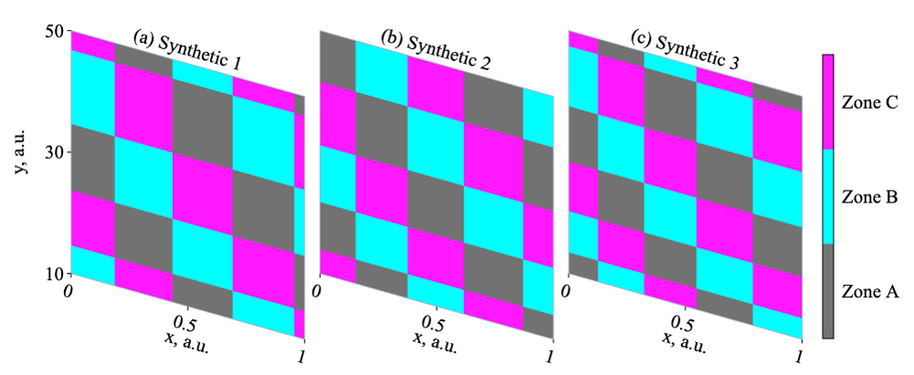

# Scientific Plotting

A MATLAB-based scientific plotting skill for creating publication-ready figures from existing numerical data. It combines instructions for interpreting and drawing a particular plot type with instructions for arranging that figure in its intended placement.

The skill is organized along two independent dimensions: **plot type** and **placement**. Each dimension can grow as new scientific figures and output contexts are added.

## Two-Dimensional Design

| Dimension | Responsibility | Current options |
| --- | --- | --- |
| Plot type | Input interpretation, plotting behavior, data checks, and export requirements | Pure time series; paired phase trajectory and waveform; categorical bifurcation slices |
| Placement | Target document context, physical dimensions, panel arrangement, margins, and spacing | Full width in a one-column document; one column in a two-column document; spanning both columns in a two-column document |

For each task, select one plot type and one placement. The agent reads the corresponding reference from each dimension and applies both together with the common rules in [SKILL.md](scientific-plotting/SKILL.md). For example, the same time-series workflow can produce a full-width figure for a one-column article or a vertically stacked figure occupying one column of a two-column article.

The default placement is full width in a one-column document. Explicit user dimensions override the corresponding preset fields. The available physical presets are:

| Placement | Available presets |
| --- | --- |
| [One-column document, full width](scientific-plotting/references/placements/one-column-document-full-width.md) | Four time-series panels on a 148 × 49 mm canvas; four phase/waveform pairs with shared vertical axes within each pair on a 148 × 55 mm canvas; three slices on a 135 × 55.5 mm canvas, with additional rows and height calculated for larger slice layouts. |
| [Two-column document, one column](scientific-plotting/references/placements/two-column-document-single-column.md) | Time-series panels stacked vertically, each with a 60 × 12 mm internal plot box. The canvas includes additional space calculated from the actual labels. Other plot types require explicit layout dimensions. |
| [Two-column document, spanning both columns](scientific-plotting/references/placements/two-column-document-spanning.md) | Explicit layout dimensions are required for every plot type. |

These presets are project defaults. Confirm any additional journal requirements and resolve missing dimensions before plotting. Slice layouts in either two-column placement require complete geometry, including the canvas, slices, spacing, margins, and colorbar.

## Current Plotting Workflows

| Plot type | Included implementation | Final outputs |
| --- | --- | --- |
| [Pure time series](scientific-plotting/references/plot-types/pure-time-series.md) | Workflow instructions for a task-specific MATLAB script, including time windows, panel labels, and single or explicitly requested split vertical axes | Single-page vector PDF and a preview rendered from that PDF at 600 dpi or higher |
| [Paired phase trajectory and waveform](scientific-plotting/references/plot-types/phase-waveform.md) | Workflow instructions for a task-specific MATLAB script, with a phase trajectory on the left and a waveform on the right, independently configured time windows, and shared or independent vertical axes | Single-page vector PDF and a preview rendered from that PDF at 600 dpi or higher |
| [Categorical bifurcation slices](scientific-plotting/references/plot-types/mat-bifurcation-slices.md) | A reusable MATLAB renderer and a synthetic demo for existing categorical MAT planes, including bifurcation maps and basins of attraction | Editable FIG and a 600 dpi PNG by default; an optional smaller PNG preview |

The time-series and phase/waveform workflows guide the agent in writing a reproducible script for the supplied data. The bundled slice renderer supports FIG and PNG export.



*The bundled preview shows three synthetic slices. Its category names and colors illustrate the layout and have no universal scientific meaning.*

## Requirements

- **MATLAB R2025a or later** for the bundled slice renderer and demo, which use explicit export dimensions.
- **Times New Roman** installed for figure text. The default main text size is 8 pt, and the slice renderer reports an error if the requested font is unavailable.
- **Poppler tools**, including `pdfinfo` and `pdftoppm`, for page-size checks and PDF-derived previews in the time-series and phase/waveform workflows. The slice demo does not require them.
- **An agent that supports local skills**, such as Codex, when using the guided workflow. The MATLAB slice scripts can also be called directly.

The skill instructions, detailed workflow references, MATLAB code comments, and usage examples use American English.

## Use as a Codex Skill

Copy the entire `scientific-plotting/` directory into your research project's `.agents/skills/` directory. From this repository's root:

```bash
mkdir -p /path/to/your/project/.agents/skills
cp -R scientific-plotting /path/to/your/project/.agents/skills/
cp LICENSE /path/to/your/project/.agents/skills/scientific-plotting/
```

For a user-wide installation, use `~/.agents/skills/` as the destination and include the license in the installed skill folder. Keep its `SKILL.md`, `references/`, `scripts/`, `assets/`, and `agents/` files together. See the [official Codex skill documentation](https://developers.openai.com/codex/skills/) for discovery locations and invocation details. If the newly installed skill does not appear, restart Codex.

Invoke `$scientific-plotting` and specify the plot type, placement, source files, variable mappings, units, desired ranges, and output location. Include file order, colors, category definitions, and physical dimensions when relevant. For example:

**Pure time series**

```text
Use $scientific-plotting to plot data/voltage.csv as a pure time series
occupying one column of a two-column article. Use time_s for time in seconds
and voltage_V for voltage in volts. Show 0.2 to 0.4 s with a blue curve.
Write the MATLAB script, vector PDF, and PDF-derived preview to results/voltage/.
```

**Paired phase trajectory and waveform**

```text
Use $scientific-plotting to create four phase-trajectory-and-waveform pairs
from data/run_1.csv through data/run_4.csv, in that order. Use the full-width
placement for a one-column article. Each file contains time_s, x_V, and y_V.
Use x_V as the horizontal coordinate and y_V as the vertical coordinate of
each phase plot; plot y_V against time_s in each waveform. Both variables
are voltages in volts; use 1 to 2 s for both views and black curves.
Write the reproducible script and final figures to results/phase/.
```

**Categorical slices**

```text
Use $scientific-plotting to render data/map_1.mat, data/map_2.mat, and
data/map_3.mat as categorical slices, in that order, with the full-width
placement for a one-column article. Use the coordinate vectors, matrix
orientation, category definitions, and colors documented in data/metadata.txt.
Write the adapter script, editable FIG, and 600 dpi PNG to results/slices/.
```

Relative data and output paths in these requests refer to the research project. Keep source data, task-specific scripts, and generated figures outside the installed skill directory.

## Run the MATLAB Demo

Set `skill_root` to the actual skill directory, then run:

```matlab
skill_root = '/absolute/path/to/scientific-plotting-skill/scientific-plotting';
addpath(fullfile(skill_root, 'scripts'), '-begin');
which render_bifurcation_slices

output_dir = fullfile(tempdir, 'scientific_plotting_demo');
[fig, ax, cb] = demo_bifurcation_slices(3, output_dir);
```

The demo creates three small synthetic MAT files, reloads them through an explicit field mapping, and renders three slices. The output directory contains:

- `synthetic_slice_01.mat`, `synthetic_slice_02.mat`, and `synthetic_slice_03.mat`.
- `demo_3_slices.fig`, an editable MATLAB figure.
- `demo_3_slices.png`, the main 600 dpi export.
- `demo_3_slices_preview.png`, a smaller preview approximately 1,000 pixels wide.

The no-argument call, `demo_bifurcation_slices()`, creates **five** slices and writes to `output/bifurcation_slice_demo/` under MATLAB's current working directory. The explicit output directory above keeps generated files outside the installed skill.

These synthetic inputs demonstrate plotting and layout only. They are not simulation results, measurements, or evidence of dynamical behavior.

## Slice Renderer Interface

After adapting your verified data to the required structures, call:

```matlab
[fig, ax, cb] = render_bifurcation_slices(slices, categories, options);
```

| Input | Required contents |
| --- | --- |
| `slices` | A nonempty struct vector. Each element has coordinate vectors `x` and `y`, plus a categorical matrix `S` with size `[numel(y), numel(x)]`. Optional fields are `title`, `source_file`, and a scalar `metadata` struct. |
| `categories` | A scalar struct containing unique numeric `codes`, matching display `labels`, and an N × 3 RGB `colors` array with values in `[0, 1]`. Their order determines the shared colorbar order from bottom to top. |
| `options` | An optional scalar struct for layout, axis labels, display ranges, typography, and export settings. Unknown option names are rejected. |

Coordinates must already be in display units, finite, and strictly increasing, with at least two points per axis. **Rows of `S` correspond to `y`; columns correspond to `x`.** Different slices may use different grid sizes and nonuniform sampling. Every matrix entry must be finite and covered by `categories.codes`.

The renderer preserves each original classification sample as a flat colored cell, including the last row and column. All slices share one colorbar, so their category definitions and colors must be consistent. It returns an editable `fig`, one shared physical drawing axis `ax`, and the colorbar `cb`.

Frequently used options include:

| Options | Purpose |
| --- | --- |
| `columns`, `slice_width_mm`, `slice_height_mm`, `slice_drop_mm` | Number of columns and slice geometry |
| `slice_gap_mm`, `row_gap_mm`, `margins_mm` | Spacing and margins; margin order is `[left, bottom, right, top]` |
| `figure_mm`, `colorbar_mm` | Canvas `[width, height]` and colorbar `[left, bottom, width, height]`, in millimeters |
| `x_limits`, `y_limits`, `x_ticks`, `y_ticks`, `x_label`, `y_label` | Coordinate display and labeling |
| `output_prefix`, `formats`, `resolution`, `preview_width_px` | Output path without an extension, FIG/PNG format selection, resolution, and optional preview width |

An empty `output_prefix` creates a figure without writing files. With a nonempty prefix, the defaults export FIG and PNG at 600 dpi. The renderer's layout defaults implement the one-column-document placement; provide complete placement-specific geometry for either two-column context.

See the [slice workflow reference](scientific-plotting/references/plot-types/mat-bifurcation-slices.md) for MAT adaptation and detailed checks, and [the renderer](scientific-plotting/scripts/render_bifurcation_slices.m) for the complete `default_options` definition.

## Data Preservation and Verification

- Treat original files as read-only and preserve their verified sample order, category definitions, and provenance. Default rendering uses the original samples without interpolation, smoothing, or downsampling.
- Confirm variables, units, coordinate orientation, and category meanings from the actual source. Keep unit conversions and display mappings explicit in the task-specific adapter.
- Use existing data for plotting. Simulation, model changes, numerical solving, classification design, and dynamical interpretation fall outside the current workflows.
- Check the selected samples or category cells, figure dimensions, fonts, labels, colors, and output files. Inspect a high-resolution rendering for clipping, overlap, and unnecessary whitespace. Explicit millimeter dimensions have a 0.1 mm tolerance.
- Follow the selected plot type's export checks: inspect the final vector PDF and its derived preview for line plots; inspect the exported PNG and reopened editable FIG for slices.

## Extending the Skill

Extend the two dimensions independently:

1. **Add a plot type** under `scientific-plotting/references/plot-types/`, defining its input contract, rendering behavior, outputs, and verification. Add reusable MATLAB scripts when the workflow benefits from them.
2. **Add a placement** under `scientific-plotting/references/placements/`, defining the target context, dimensions, arrangement, and required user inputs. Presentation slides and other output contexts are possible future placements.
3. Register the new route in `SKILL.md` and document any compatibility requirements between the new reference and existing references. Update examples and verification as needed.

The current package supplies the three plot types and three article placements listed above. Additional plot families and presentation-oriented placements remain future extensions.

## Repository Layout

```text
.
├── .gitignore
├── AGENTS.md
├── LICENSE
├── README.md
└── scientific-plotting/
    ├── SKILL.md
    ├── agents/
    │   └── openai.yaml
    ├── assets/
    │   └── default-three-slice-preview.png
    ├── references/
    │   ├── placements/
    │   └── plot-types/
    └── scripts/
        ├── demo_bifurcation_slices.m
        └── render_bifurcation_slices.m
```

## Repository Maintenance

See [AGENTS.md](AGENTS.md) for repository maintenance and publication instructions. These instructions are separate from the working-project instructions followed when using the skill.

## License

Copyright (c) 2026 Pierson Bian. Released under the [MIT License](LICENSE).
